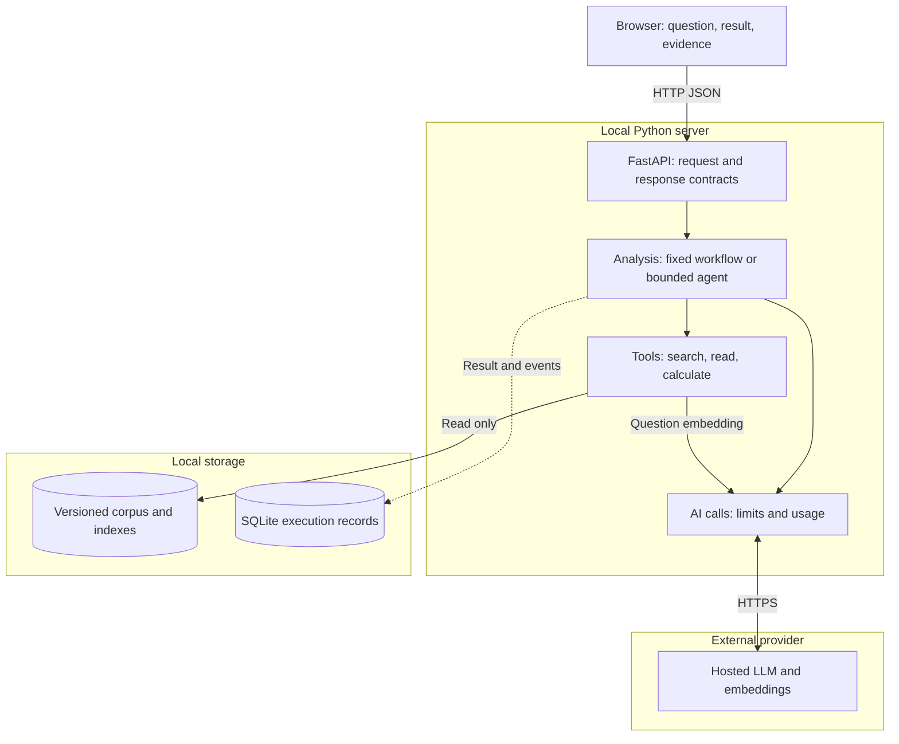
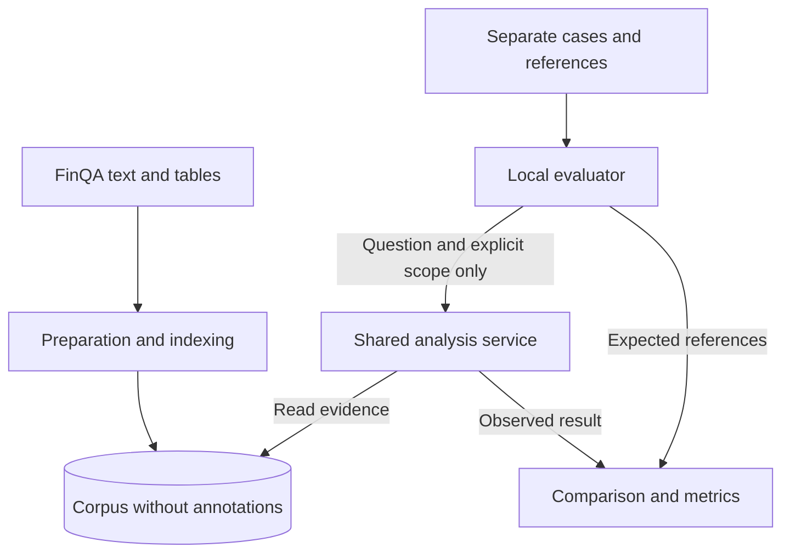

# FigureTrail architecture

**Version 1.1 — target design dated 24 October 2026; implementation status updated 26 October 2026 — Fekher Jarrar.**

FigureTrail answers simple numerical questions about public reports. It finds evidence, calculates a result and shows a verifiable analysis: values, periods, units, sources and formula. Example: “What was the percentage change in this measure between these two years?”

The design uses a measurable fixed workflow, followed by a bounded agent variant. P0 covers LLM/RAG, API contracts and evaluations. P1 adds tools, security and observability. Reference data, the health API, provider connection, controlled source selection and one bounded native tool call are verified. Retrieval and the fixed CLI analysis workflow are now implemented and measured on development cases; analysis API integration remains planned.

Diagrams use Markdown and Mermaid so they can be reviewed and versioned with code. [GitHub diagram support](https://docs.github.com/en/get-started/writing-on-github/working-with-advanced-formatting/creating-diagrams).

The [engineering blueprint](AI_PROJECT_BLUEPRINT.md), [standards review](../verification/AI_PROJECT_BLUEPRINT_REVIEW.md) and [backlog](../Backlog/BACKLOG.md) define supporting standards and adoption order. Add files, tools and services only when the current issue needs them.

## 1. System overview

Blocks represent responsibilities, not microservices. The API, orchestration and tools run in **one local Python process**. Preparation and evaluation are separate local commands.



Trust boundaries:

- The provider receives only the question, necessary excerpts and permitted instructions/tool definitions. The API key stays in Python.
- The server reads a prepared corpus. The UI cannot ingest arbitrary PDFs, files or URLs.
- Expected answers, FinQA programs and gold evidence remain in the evaluator, outside indexes and analysis prompts.
- The evaluator calls the same analysis service as the API, then compares the output with references outside that service.
- Code enforces permissions and limits independently of model compliance.

The server, preparation command and evaluator import the shared AI-call module when needed. It is a module, not another service. Preparation embeddings count toward the same cumulative spending limit.



## 2. Technical choices

Python, FastAPI, Pydantic, Uvicorn, NumPy and SQLite FTS5 were verified in B02. Google GenAI SDK 2.33.0, a generation/embedding connection check and the [B03 source-case pilot](../verification/B03_SOURCE_CASE.md) are verified. `app/llm.py` centralizes SDK requests and SQLite call allowances. The [prepared source corpus](../verification/B04_CORPUS_PREPARATION.md) is verified: 20 contexts, 186 chunks and 243 cells. The [SQLite/vector bundle](../verification/B04_INDEX_BUILD.md) is also verified: 186 rows at 768 dimensions. B05 retrieval and B06 fixed CLI analysis/calculation are verified within bounded source-format rules; analysis API integration remains planned. One source-bound `read_evidence` native call is verified in the [B03 tool check](../verification/B03_TOOL_CALL.md). See [B02 verification](../verification/B02_ENVIRONMENT.md).

| Need | Initial choice | Reason and limitation |
|---|---|---|
| Runtime | Python in an isolated environment, locked dependencies | Reproducible setup with verified Windows compatibility. |
| API and contracts | FastAPI, Pydantic and Uvicorn | Typed boundaries and OpenAPI; domain validation still belongs in the service. |
| UI | One HTML/CSS/JavaScript page served by FastAPI | Question form, result, evidence and execution details on one origin. |
| Data and SQL | Python `sqlite3` | Inspectable corpus and execution records without a separate database service. |
| Lexical baseline | SQLite FTS5 with BM25 | Simple measured baseline. Verify FTS5 at setup; do not build a replacement search engine. |
| Semantic retrieval | Hosted embeddings, normalized vectors and NumPy cosine similarity | A local matrix fits a corpus of a few hundred chunks. Use the same embedding model for documents and questions. |
| Generation | One hosted LLM through its official SDK | Select using measured latency/cost and verified structured-output/tool-call support. No local model is required. |
| AI-call boundary | One module with generation and embedding functions | Central configuration, limits, errors and usage; no speculative provider abstraction. |
| Calculation | `Decimal` and an allowlist of formulas | The model selects cell IDs; code reads and calculates from source values. |
| Evaluation | Python command, JSONL cases and targeted tests | Repeatable measurements and boundary checks without a paid LLM judge. |
| Observability | SQLite execution database and JSON/CSV export | Inspectable records without an additional subscription. |
| Versioning | Git for code, prompts, non-secret configuration and manifests | Every result identifies its experiment conditions. |

References: [FastAPI validation](https://fastapi.tiangolo.com/tutorial/body/), [Python SQLite](https://docs.python.org/3/library/sqlite3.html), [FTS5/BM25](https://sqlite.org/fts5.html), [NumPy dot product](https://numpy.org/doc/stable/reference/generated/numpy.dot.html). Cosine search requires normalized vectors; reject zero vectors and incompatible dimensions.

The [B03 provider decision](PROVIDER_SELECTION.md) selects Google's Gemini Developer API with `gemini-3.5-flash-lite` and `gemini-embedding-2`, starting free. The one-case pilot passed its 0.950 s median latency gate and selected the reviewed cells three times. [Free-tier account quotas](../verification/B03_ACCOUNT_LIMITS.md) are recorded; one bounded [native tool call](../verification/B03_TOOL_CALL.md) is also verified. Broader task quality and multi-step agent behavior remain unverified. A prompt requesting JSON does not establish structured-output or tool-call support. Configure API access and any later billing separately.

## 3. Data scope and preparation

Start from a public [FinQA](https://github.com/czyssrs/FinQA) subset. The first ten cases were verified on 24 October 2026; see [B01 verification](../verification/B01_DATA_VERIFICATION.md). The source-selection pilot measures one controlled example. The B04 corpus/index bundle is verified; end-to-end answer evaluation remains planned.

### Initial scope

- Target 20–40 report contexts and at most 500 chunks, subject to inspection.
- Use English questions and sources.
- Support **percentage change** and **percentage ratio**, each using two table cells with explicit, compatible units and scales.
- Keep text for context and retrieval. Arbitrary numerical extraction from paragraphs is outside the initial scope.
- Display company, period and title only when present or verified. Otherwise retain an opaque document ID.

B04's offline implementation uses `app/corpus.py` and `python -m scripts.prepare_corpus`. A pinned twenty-filename source selection drives preparation independently of evaluation references. Generated JSON is a validated intermediate artifact. `app/embeddings.py` caches/paces document vectors, `app/storage.py` publishes and validates SQLite/FTS5 plus vectors, and `python -m scripts.build_index` rebuilds from cache; only `--live` allows missing embedding requests. The complete bundle below is verified and remains separate from the service until analysis integration.

### Separate corpus and references

Preparation deduplicates usable contexts and produces two outputs:

1. **Inference corpus:** text, tables, verified metadata, cells and identifiers. An indexed table row includes its headers, label, unit and relevant context. Reduce oversized chunks without separating a number from its meaning.
2. **Evaluation cases:** reviewed questions, evidence references, operation, result, units and tolerances. FinQA annotations support curation but never become analysis inputs.

The application does not load the raw dataset or evaluation files. Check inference artifacts and model requests for annotation leakage. Do not add reference question/answer pairs to chunks.

| Artifact | Required information |
|---|---|
| Document | `report_id`, provenance, content hash and available metadata. |
| Chunk | `source_id`, `report_id`, text/table type, indexed content and row/cell references. |
| Cell | `cell_id`, row, column/period, label, original text, normalized decimal value, unit/scale and source reference. |
| Corpus manifest | Preparation version, corpus hash, document list, embedding model/dimension and exact matrix-row-to-chunk mapping. |
| Evaluation case | `case_id`, report group, split, question, expected state/result, evidence, units and tolerances. |

Build a complete versioned bundle containing `corpus.sqlite`, vectors and a manifest before starting the server. Validate their alignment at load time and reject inconsistent bundles. Keep `runs.sqlite` separate so corpus rebuilds preserve execution records.

A source change creates a new corpus version. Previous results retain the old version; the UI identifies the difference and offers an explicit rerun.

## 4. P0 fixed workflow

```mermaid
sequenceDiagram
    actor U as User
    participant A as FastAPI
    participant S as Analysis service
    participant R as Retrieval and corpus
    participant M as Hosted AI calls
    participant C as Validation and calculation
    participant T as SQLite execution records
    U->>A: Question and document scope
    A->>S: Validated input, fixed mode
    S->>T: Create run_id and record versions
    S->>R: Search for evidence
    opt Semantic variant
        R->>M: Embed question
        M-->>R: Vector and usage
    end
    R-->>S: Ranked chunks, cells and sources
    alt Candidate evidence available
        S->>M: Question, evidence and output schema
        M-->>S: Operation and cell references, or abstention
        S->>C: Validate references, units and operation
        C->>R: Read permitted source values
        R-->>C: Values and provenance
        C-->>S: Verifiable result or explicit outcome
    else No usable candidates
        Note over S: Insufficient evidence; do not invent values
    end
    S->>T: Save result, usage, duration and errors
    S-->>A: Structured result and evidence
    A-->>U: Analysis result
```

Use one search, at most one generation call and a deterministic calculation. Semantic mode also embeds the question. Establish the lexical baseline before comparing semantic retrieval.

### Retrieval and scope

Search across multiple contexts, including distractors. Never supply the correct document through gold annotations. Default scope is the full corpus; filters must come from explicit user input.

B05 fixes five candidate chunks, retains ranks/scores/cell IDs and compares prefixes at k=1/3/5. Scope is applied before top-k; ties use corpus order. The provisional B06 choice is semantic k=5 (10/10 complete development proofs), with lexical retained as a local comparison (9/10). Lexical performs better at k=3. See [measured comparison and limitations](../verification/B05_RETRIEVAL.md). No hits or low similarity alone do not prove that information is absent.

The implemented retrieval comparison uses the same corpus and questions without a calculator; B06 implements shared calculation and an initial workflow campaign; B08 will broaden comparisons. `app/retrieval.py` performs literal FTS5/BM25 or exact NumPy cosine search; `evals/retrieval.py` loads references only after retrieval. Separate query embeddings reuse the shared provider and journal. Missing vectors require `--live`. A remote vector database is unnecessary for the initial workload.

### Cell selection and calculation

The LLM proposes a state, operation and two cell IDs. Freely generated numbers are never operands. Code:

1. Validates the schema, IDs and access to those cells within this execution.
2. Resolves source values, labels, periods, units and scales.
3. Rejects missing units, incompatible scales, unsupported operations and invalid denominators.
4. Calculates `100 × (new − old) / old` or `100 × numerator / denominator` using `Decimal`.
5. Builds the displayed formula, operands, output unit and source references. Display rounding is separate from the internal result.

Require strictly positive bases/denominators to avoid ambiguous negative-base conventions. Do not implicitly convert currency, scale or period. Never execute `eval`, generated Python or generated SQL.

Valid cells can still be the wrong cells for a question. Reference integrity and correct arithmetic do not establish semantic relevance; evaluations must assess it separately.

Current implementation: `app/service.py` runs one retrieval and at most one structured generation using `prompts/analysis_selection.md`; `app/calculator.py` validates listed source cells and calculates with an explicit Decimal context. `scripts/analyze.py` and `evals/analysis.py` share that service. Exact repeated payload lines are retained once per source, with all candidate cells preserved. Initial supported unit/period shapes and the conservative abstentions are specified in [B06 verification](../verification/B06_FIXED_WORKFLOW.md). The service records each execution in the shared journal's `analyses` table; provider calls remain in `calls`. Initial 504 failures and 15–19 s follow-up latency remain limitations.

## 5. API and result contracts

| Route | Responsibility |
|---|---|
| `GET /` | Serve the demonstration UI. |
| `GET /health` | Report process availability and loaded corpus version without provider calls. Implemented. |
| `GET /reports` | List selectable document scopes without evaluation annotations. |
| `POST /analyses` | Accept a question, optional `report_ids` and `fixed` or `agent` mode. |
| `GET /analyses/{run_id}` | Read a stored result and evidence without another AI call. |
| `GET /docs` | Interactive API documentation generated from OpenAPI. Available for current routes. |

Except for the current health endpoint and documentation, these routes are planned. Retrieval mode is versioned experiment configuration, not an unrestricted API option. Agent mode remains unavailable until implemented.

The result includes `run_id`, state, mode, scope, evidence, available operation/operands/result, versions and an optional error code. Execution details expose durations and usage. Unknown values remain absent or `null`, rather than becoming zero.

| State | Meaning |
|---|---|
| `success` | References and calculation passed validation; semantic accuracy is measured separately. |
| `insufficient_evidence` | Available evidence cannot establish the operands and their context. |
| `unsupported_request` | The calculation or context is outside the supported scope. |
| `blocked` | Budget, step count, deadline or permissions prevent further work. |
| `failed` | Technical error, provider refusal, truncation or invalid schema; retain a specific error code. |

A completed analysis may return HTTP 200 with a non-success outcome. Use 422 for invalid input, 404 for unknown executions, 502/504 for provider failures and 409 for rejected concurrent work. Errors after execution creation retain a retrievable `run_id`. Do not expose sensitive exception details to the browser.

Keep processing synchronous and bounded, with a waiting indicator and one active analysis at a time. A distributed queue is outside the current scope.

## 6. P1 bounded agent

The agent reuses retrieval, cells, calculations, validation and result contracts. The model chooses the next action; the program enforces permissions.

| Tool | Allowed input | Code-enforced boundary |
|---|---|---|
| `search_evidence` | Text query | Immutable execution scope; bounded query and results. |
| `read_evidence` | Previously retrieved source IDs | Associated context and cells only; no arbitrary file paths or URLs. |
| `calculate` | Allowed operation and cell IDs | Cells from evidence read during this execution; shared unit checks and deterministic formulas. |

Start with the question and tool definitions. The model can search, read, revise a query, calculate or abstain. Stop after a valid calculation and build the final result in code; do not ask the model to recalculate it.

Initial limits: **four generation calls and six tool calls, including at most two searches**, with one tool call at a time. Structured tool errors count toward the limits. Reject unknown tools and out-of-scope access. Accept structured abstention without calculation; reject unsupported numerical final text as a success.

Measure these initial settings. Keep the fixed workflow as the default if the agent increases cost without a useful improvement.

## 7. Security, reliability and operations

### Trust boundaries

- Treat user input, sources and tool output as untrusted. Separate system instructions and test indirect prompt injection.
- Initially limit questions to 2,000 characters, candidates to five chunks and context to 20,000 characters. Preserve headers and units when reducing content; otherwise report unusable evidence.
- Expose only the three permitted tools. No autonomous browser, shell, generated-code execution, file writing or arbitrary SQL.
- Escape displayed source text so embedded HTML and scripts remain inactive.
- Keep secrets in the local environment. Example configuration contains variable names only. Exclude keys from Git, UI, traces, screenshots and published errors.
- Bind to `127.0.0.1`, validate allowed origins, require JSON analysis requests and avoid permissive CORS. Public multi-user deployment is outside scope.

RAG and prompt delimiters do not guarantee injection resistance. Code restrictions and adversarial checks remain necessary. [OWASP](https://genai.owasp.org/llmrisk/llm01-prompt-injection/).

### Calls and spending

- Initial validation allowance: **€20 API usage plus €5 reserve**, within a cumulative ceiling strictly below €30. Reconcile estimates against provider billing.
- Count preparation and question embeddings, evaluations, agent trials, retries and failures.
- Pilot a few cases before a batch; estimate campaign cost and set case/repetition counts in advance.
- Check estimated spend before every call and use provider limits where available. Local estimates alone cannot guarantee a billing cap; allow for prices, currency conversion and delayed reporting.
- Start with a 1,000-token output cap, a 20-second provider timeout and a 60-second end-to-end deadline. Pass remaining time to calls; start none after the deadline.
- Disable hidden SDK retries. Initially, do not automatically retry timeouts or invalid responses. Additional attempts must be explicit, bounded and recorded.
- Reuse embeddings for an unchanged corpus. Reading a stored result makes no model call; rerunning creates a new execution.

The source-case pilot records three generation timings and dated conservative cost estimates. Initial report-analysis latency and provider failures are now measured in B06; broader capacity and actual charges remain unverified. The current provider module atomically reserves €1/generation or €0.01/embedding against a €25 local allowance cap in `data/local/runs.sqlite`; unknown usage retains its reservation. See the [pilot report](../verification/B03_SOURCE_CASE.md) for accounting assumptions and limits. Reject an unsuitable model during B03 before building around it.

### Execution records

Store in `runs.sqlite`: `run_id`, state, date, public question, scope, mode, code/prompt/corpus/index/configuration versions, requested and returned model IDs where available, retrieved sources/ranks, allowed tool arguments, result, errors, durations, tokens and estimated cost with dated prices.

Each event includes `run_id`, type and duration. Record failures; leave unknown usage unknown. Retain diagnostic structured responses without requesting or storing private chain of thought. Keep SQLite transactions short and closed during network calls. A critical recording failure must stop further untracked paid calls.

Expose execution details in the UI and allow SQL/CSV inspection. External observability services are optional.

## 8. Evaluation

### Cases and separation

Begin with ten reviewed development cases. Working target: **about 40 cases** — 20 development, 10 reserved final cases and 10 robustness cases. Development/final sets include insufficient-evidence cases. Finalize counts after inspection, before final measurement.

Split by report group and detect duplicate contexts. Final documents may appear in the retrieval corpus; their reference answers may not be used for tuning. If a final case informs a fix, disclose that use and replace it in the reserved set.

Build identified corpus variants for missing-evidence tests, verifying that required information is absent even after duplicate checks. An abstention instruction is not such a test. Use separate modified-source variants for injections and retain the changes in evaluation assets.

FinQA is public and may have appeared in model training. Add controlled paraphrases/variants without claiming broad generalization or a result comparable to the full FinQA benchmark.

| Metric | Measurement rule |
|---|---|
| Retrieval | Evidence recall@k and cases with all required evidence in the candidates. Only the evaluator reads gold annotations. |
| Numerical accuracy | Compare canonical results with explicit absolute/relative tolerances and normalized units. Distinguish 0.12 from 12%. |
| Task success | Correct state, calculation, units, periods and relevant evidence; publish counts and error categories. |
| Evidence support | Automatically check references; review semantic support, labels and periods on a documented sample. |
| Abstention | Separate justified abstention on incomplete cases from incorrect abstention on answerable cases. |
| Guardrails | Count observed forbidden tool execution, scope violations, unsupported numerical success and active displayed HTML. |
| Execution failures | Include invalid schemas, refusals, timeouts and limits in stated denominators. |
| Latency and cost | Total duration, median/spread, tokens and estimated cost; state sample size, failures and conditions. |

A valid JSON object, existing citation or self-judgment by the same model does not establish correctness. Reviewed evidence and numerical references are the main checks.

Compare **fixed lexical**, **fixed semantic**, then **agent with the selected retriever**. Change one dimension at a time. Tune on development cases, then compare frozen variants on reserved cases. Repeat a small sample if budget permits; temperature zero is not a determinism guarantee.

Set numerical acceptance thresholds before final trials, informed by initial measurements and demonstrated requirements. No success rate is established yet. Fix any code-permission violation; zero observed violations does not prove universal security.

## 9. Target repository layout

Create these modules only as their features are implemented:

```text
app/
  main.py           # API routes and demonstration page
  schemas.py        # request, plan, tool, result and error contracts
  service.py        # fixed workflow and shared checks
  agent.py          # bounded loop, added after the fixed baseline
  retrieval.py      # search, evidence reads and scope
  calculator.py     # cells, units and permitted operations
  llm.py            # selected SDK, limits, usage and errors
  corpus.py         # source-only preparation and artifact validation
  embeddings.py     # content-addressed cache and paced document preparation
  storage.py        # SQLite/vector publication and validated reads
  static/           # simple page, styles and JavaScript
scripts/
  prepare_corpus.py # source/chunk preparation and current-version pointer
  build_index.py    # cached/paced embedding build and bundle validation
evals/
  run.py            # call service, then read references
  cases/            # development, reserved and robustness cases
  results/          # versioned measurements and error reviews
tests/              # calculation, leakage, contracts and permissions
prompts/            # versioned prompts
data/               # local artifacts; generated paths ignored
docs/
  architecture/     # ARCHITECTURE.md and engineering standards
  Backlog/          # BACKLOG.md and detailed reference cases
  verification/     # evidence and reports; excluded from inference
README.md
.env.example        # variable names only
.gitignore
.editorconfig
pyproject.toml
uv.lock
```

Keep the application independent of `evals`; the evaluator depends on the application. Simulated network responses verify error paths without fees, while release evidence includes real model calls and measured results.

## 10. Acceptance evidence

| Priority | Required capability | Reviewable evidence | Issues |
|---|---|---|---|
| P0 LLM | Real call, output schema, validated cell selection and explicit errors | Recorded live execution and contract | B03, B06 |
| P0 RAG | Text/table preparation, multi-source retrieval and lexical/semantic comparison | Ranked evidence, retrieval metrics and error review | B04, B05, B08 |
| P0 APIs/architecture | Typed API, distinct responsibilities and shared service | OpenAPI, request/response example and boundary checks | B02, B07, B09 |
| P0 AI evaluations | Separate references, reserved cases and measured comparisons | Repeatable command, counts and results | B01, B08, B13 |
| P1 Agents/tools | Model-selected actions with enforced limits | Live tool decisions and fixed-workflow comparison | B10 |
| P1 Security | Code-enforced validation, permissions and limits | Negative/injection tests with documented limits | B03, B06, B07, B11 |
| P1 LLMOps | Versions, errors, usage and stale-corpus identification | Execution lookup and measurement export | B03, B12, B13 |
| Additional data work | Repeatable preparation, deduplication, metadata and SQL | Manifest, leakage check and inspectable corpus | B01, B04 |

Release gates:

1. **Feasibility:** ten verifiable cases and an acceptable hosted-model pilot. Reduce scope if needed.
2. **P0 complete:** retrieval, LLM, calculation, API and UI work together, with a recorded evaluation baseline.
3. **P1 demonstrated:** real tool choices, limit checks, inspectable traces and a measured comparison.
4. **Release ready:** documented setup, real results, failures, trade-offs and a short demonstration.

The initial ten-case data gate, provider connection and one-case source-selection latency gate are verified. Account quotas are recorded from the [AI Studio observation](../verification/B03_ACCOUNT_LIMITS.md). One bounded native call is verified; the indexed corpus is now verified in B04. Retrieval coverage is measured in B05 and an initial fixed-workflow campaign is recorded in B06, including four 504 failures. Reserved-case accuracy, multi-step agent behavior, consistent low latency and broader task-performance thresholds remain unverified. Reliability depends on implementation and these checks, rather than the diagram alone. Add cloud deployment, agent frameworks or remote vector storage only for demonstrated requirements.
