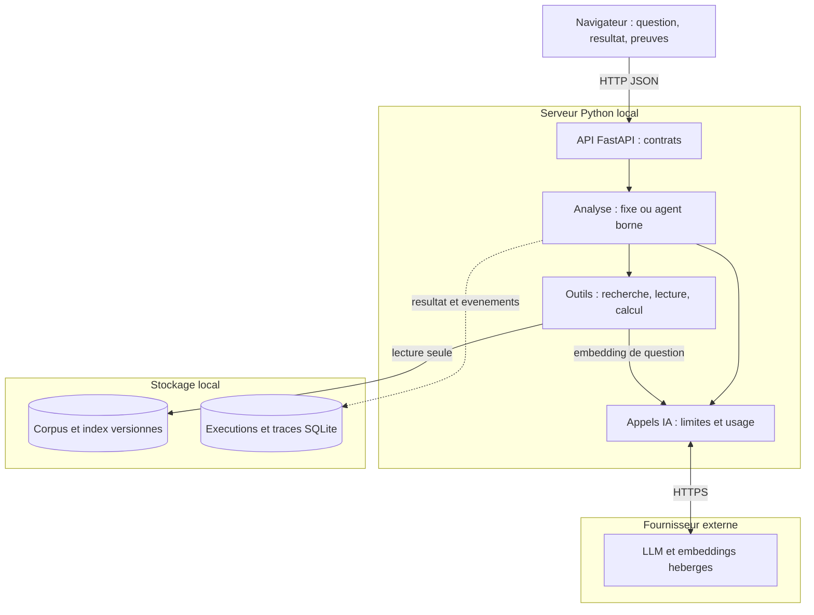
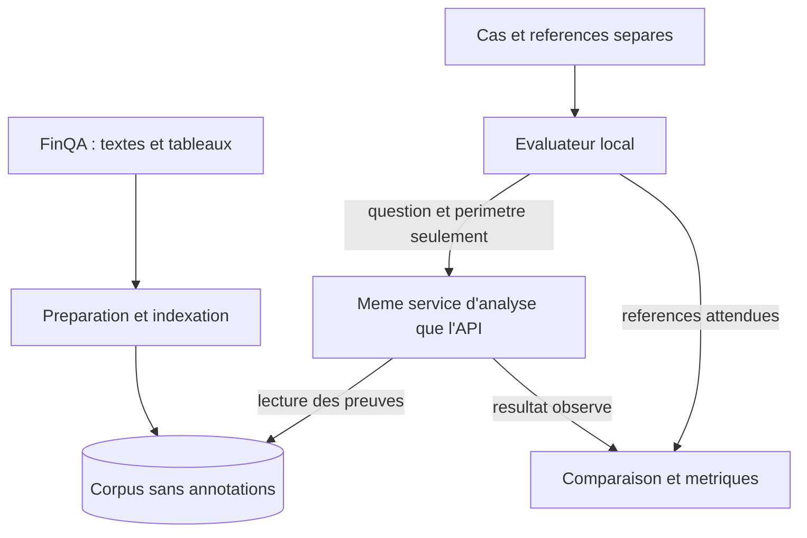
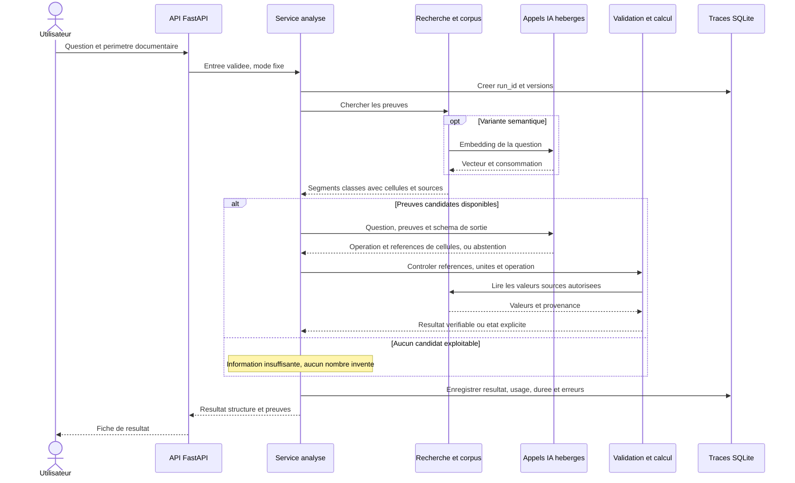

# Architecture — FigureTrail

**Version 1.0 proposée — 24 octobre 2026 — Fekher Jarrar**

**But :** poser une question simple sur des chiffres issus de rapports publics, retrouver les preuves, effectuer un calcul fiable et afficher une fiche vérifiable. Exemple de parcours : « Quelle est la variation relative de cet indicateur entre ces deux années ? » L'interface présente les valeurs, les périodes, les unités, les sources, la formule et le résultat.

Cette architecture est dimensionnée pour un projet personnel sur Windows, environ 36 heures de réalisation et d'apprentissage sur six semaines, avec moins de 30 € de dépenses supplémentaires. Elle couvre les P0 et P1 convenus. C'est une conception à éprouver, pas une architecture déjà implémentée ou une garantie de perfection. Le premier contrôle porte sur les données et l'accès au modèle.

Le format retenu est **Markdown avec Mermaid** : lisible, modifiable et versionnable avec le code. GitHub sait afficher ces diagrammes dans les fichiers Markdown. [Documentation GitHub](https://docs.github.com/en/get-started/writing-on-github/working-with-advanced-formatting/creating-diagrams).

Le [blueprint technique](AI_PROJECT_BLUEPRINT.md) complète cette conception par les standards de données, développement, évaluation et exploitation. Sa [revue sourcée](../verification/AI_PROJECT_BLUEPRINT_REVIEW.md) explique les recommandations. Le [backlog](../Backlog/BACKLOG_PROJET_IA.md) fixe leur adoption progressive ; aucun dossier, outil ou service supplémentaire n'est requis sans besoin à l'étape en cours.

## 1. Schéma d'architecture

Les blocs représentent des responsabilités, pas des microservices. L'API, l'orchestration et les outils tournent dans **un seul processus Python local**. La préparation des données et les évaluations sont des commandes locales exécutées séparément.



**Frontières importantes :**

- Le fournisseur reçoit uniquement la question, les extraits nécessaires et les instructions/outils autorisés. La clé API reste côté Python.
- Le serveur lit un corpus déjà préparé. Aucune ingestion libre de PDF, de fichier ou d'URL par l'interface.
- Les réponses attendues, programmes FinQA et annotations de bonnes preuves restent dans l'évaluateur. Ils n'alimentent ni l'index ni les prompts d'analyse.
- L'évaluateur appelle le même service d'analyse que l'API. Il compare ensuite les résultats aux références, hors de ce service.
- Les limites et permissions sont exécutées par le code. Elles ne dépendent pas de l'obéissance du modèle.

Le module « Appels IA » est importé par le serveur, la préparation et l'évaluateur lorsqu'ils en ont besoin. Ce n'est pas un service supplémentaire : chaque commande l'exécute dans son propre processus. La consommation des embeddings de préparation entre aussi dans le suivi global des dépenses.

La vue ci-dessus montre le fonctionnement de l'application. La préparation et la séparation des évaluations sont précisées dans la vue de données suivante ; les retours de résultat sont détaillés dans le diagramme de séquence de la section 4.



## 2. Choix techniques recommandés

Ces choix forment une base concrète pour le backlog. Le socle Python/FastAPI/Pydantic/Uvicorn/NumPy et SQLite FTS5 est testé en B02 : voir le [rapport B02](../verification/B02_ENVIRONNEMENT.md). Le corpus, le LLM, les embeddings, les outils et le service d'analyse restent à construire et à mesurer.

| Besoin | Choix de départ | Justification et limite |
|---|---|---|
| Langage | Python, environnement isolé, dépendances figées après le premier essai | Réutiliser tes connaissances et garder un démarrage Windows simple. |
| API et contrats | FastAPI, Pydantic, serveur Uvicorn | Entrées/sorties typées et documentation OpenAPI ; validation métier complémentaire dans le service. |
| Interface | Une page HTML/CSS/JavaScript servie par FastAPI | Formulaire, résultat, preuves et détail d'exécution ; même origine que l'API, un seul serveur. |
| Données et SQL | `sqlite3` de Python | Corpus consultable et traces locales sans service de base à administrer. |
| Recherche de référence | SQLite FTS5, classement BM25 | Mesure lexicale simple. Vérifier FTS5 dès l'installation ; ne pas écrire un moteur de recherche maison si le runtime ne le fournit pas. |
| Recherche sémantique | Embeddings hébergés, vecteurs normalisés et similarité cosinus avec NumPy | Quelques centaines de segments au maximum : une matrice locale suffit. Même modèle d'embedding pour corpus et questions. |
| Modèle génératif | Un LLM hébergé, via le SDK officiel du fournisseur retenu | Sélection précoce sur latence, coût, sortie structurée et appels d'outils réels. Aucun modèle local requis. |
| Appels IA | Un module Python avec deux fonctions : génération et embeddings | Centraliser configuration, limites, erreurs et consommation. Pas d'abstraction multi-fournisseur à développer. |
| Calcul | `Decimal` et formules explicitement autorisées | Le modèle choisit des références de cellules ; le code lit leurs nombres et calcule. |
| Évaluations et tests | Commande Python, cas JSONL, vérifications ciblées | Mesures répétables, tests des frontières et comparaison des variantes ; pas de dépendance à un juge LLM payant. |
| Observabilité | Une base SQLite d'exécutions et un export JSON/CSV | Traces inspectables, sans abonnement supplémentaire. |
| Versionnement | Git : code, prompts, configuration sans secrets, manifeste des données | Associer chaque mesure à une version identifiable. |

Sources techniques : [corps de requête et validation FastAPI](https://fastapi.tiangolo.com/tutorial/body/), [SQLite dans Python](https://docs.python.org/3/library/sqlite3.html), [FTS5 et BM25](https://sqlite.org/fts5.html), [produit scalaire NumPy](https://numpy.org/doc/stable/reference/generated/numpy.dot.html). La similarité cosinus suppose la normalisation préalable des vecteurs ; un vecteur nul ou une dimension incompatible doit être rejeté.

**À trancher au premier essai :** fournisseur, modèles, tarifs et accès effectifs. Le modèle génératif doit proposer une sortie structurée exploitable et le tool calling ; un simple JSON demandé par prompt ne suffit pas à annoncer ces capacités. Choisir des modèles concrets après vérification, puis figer leur configuration. L'abonnement ChatGPT existant ne constitue pas un budget API acquis.

## 3. Périmètre de données et préparation

Point de départ : un sous-ensemble public de [FinQA](https://github.com/czyssrs/FinQA), dont la documentation décrit textes, tableaux et annotations d'évaluation. Les dix premiers cas sont vérifiés au 24 octobre 2026 : voir le [rapport B01](../verification/B01_VERIFICATION_DONNEES.md). Le corpus indexé et les essais LLM restent à réaliser.

### 3.1 Limites de la première version

- Environ 20 à 40 contextes documentaires, avec un plafond de travail de 500 segments. Ce sont des cibles à ajuster après inspection.
- Questions et sources en anglais au départ, pour ne pas ajouter une tâche de traduction.
- Deux familles de calcul : **variation relative en pourcentage** et **ratio en pourcentage**. Deux valeurs issues de tableaux, avec unités et échelles explicites et compatibles.
- Textes conservés pour le contexte et la recherche. L'extraction de nombres arbitraires depuis des paragraphes n'est pas nécessaire au premier périmètre.
- Période, entreprise et titre affichés seulement s'ils sont réellement présents ou vérifiés. Sinon, conserver un identifiant documentaire opaque, sans inventer les métadonnées.

### 3.2 Deux sorties strictement séparées

La préparation sélectionne les contextes selon leur exploitabilité, déduplique les documents et produit :

1. **Un corpus d'inférence** : uniquement textes, tableaux, métadonnées vérifiées, cellules et identifiants. Chaque ligne de tableau indexée transporte ses en-têtes, son libellé, son unité et le contexte utile. Un segment trop grand est réduit sans séparer le nombre de son sens.
2. **Un jeu d'évaluation** : question, références de preuves, opération attendue, résultat, unité et tolérances relus. Les annotations FinQA sont des aides à vérifier, jamais des entrées de l'analyse.

Le dossier brut et le jeu d'évaluation ne sont pas chargés par l'application. Des contrôles vérifient l'absence des champs d'annotation dans les artefacts d'inférence et les requêtes au modèle. Les exemples de questions/réponses ne sont pas ajoutés aux segments.

### 3.3 Artefacts et identifiants

| Élément | Informations minimales |
|---|---|
| Document | `report_id`, provenance, hash du contenu, métadonnées disponibles. |
| Segment | `source_id`, `report_id`, type texte/tableau, contenu indexé, références de lignes/cellules. |
| Cellule | `cell_id`, ligne, colonne/période, libellé, valeur d'origine, valeur décimale normalisée, unité/échelle et référence documentaire. |
| Manifeste du corpus | Version de préparation, hash du corpus, liste des documents, modèle/dimension d'embedding, correspondance exacte des lignes de matrice avec les segments. |
| Cas d'évaluation | `case_id`, groupe documentaire, partition, question, état/résultat attendu, preuves, unités et tolérances. |

Utiliser un répertoire de corpus versionné contenant `corpus.sqlite`, les vecteurs et le manifeste. Le construire entièrement avant de démarrer le serveur ; vérifier les correspondances au chargement et refuser un index incohérent. Garder `runs.sqlite` séparé : reconstruire le corpus ne doit pas effacer les exécutions.

Une source modifiée produit une nouvelle version du corpus. Les anciens résultats conservent l'identité de l'ancienne version ; l'interface signale cette différence avant un recalcul explicite.

## 4. Parcours fixe P0 : référence à mesurer



Le parcours fixe comporte une recherche, un appel génératif au maximum, puis le calcul par le code. Le mode sémantique ajoute l'embedding de la question. La version lexicale permet de construire une référence avant la comparaison sémantique.

### 4.1 RAG réel et périmètre

La recherche porte sur plusieurs contextes, avec distracteurs. Elle ne reçoit pas le document contenant la bonne réponse par l'intermédiaire des annotations. Le périmètre par défaut est tout le corpus ; un filtre est permis uniquement lorsqu'il est fourni explicitement dans la demande utilisateur.

Commencer par les six meilleurs segments, conserver leurs scores et dédupliquer les résultats. Ce nombre est un paramètre de départ à ajuster sur les cas de développement. L'absence de résultat de recherche et une faible similarité ne constituent pas, à elles seules, une preuve de l'absence d'information.

Comparer **lexical** et **sémantique** avec le même corpus, les mêmes questions et le même calcul. Garder la variante la mieux justifiée par les mesures. Le RAG n'exige pas une base vectorielle distante ; la recherche doit surtout être utile, traçable et évaluée.

### 4.2 Le modèle sélectionne ; le code calcule

La sortie du LLM contient un état proposé, l'opération et les identifiants des deux cellules. Les nombres retournés librement par le modèle ne servent pas d'opérandes. Le programme :

1. Vérifie le schéma, les identifiants et leur appartenance aux preuves accessibles dans cette exécution.
2. Retrouve les valeurs dans le corpus, avec leurs libellés, périodes, unités et échelles.
3. Refuse une unité manquante, des échelles incompatibles, une opération non prévue ou un dénominateur nul.
4. Calcule avec `Decimal` : `100 × (nouveau − ancien) / ancien`, ou `100 × numérateur / dénominateur`.
5. Construit le résultat affiché : formule, opérandes, unité de sortie et sources. L'arrondi d'affichage reste distinct du résultat interne.

Le premier périmètre utilise des bases/dénominateurs strictement positifs pour éviter les conventions ambiguës de variation sur une base négative. Il n'effectue pas de conversion implicite de devise, d'échelle ou de période. Aucun `eval`, code Python généré ou SQL généré n'est exécuté.

**Limite à mesurer :** des cellules existantes peuvent être les mauvaises cellules pour la question. L'intégrité des références et du calcul ne prouve pas la pertinence sémantique ; celle-ci fait partie des évaluations et de la relecture des preuves.

## 5. Contrat de l'API et états

| Route proposée | Fonction |
|---|---|
| `GET /` | Interface de démonstration. |
| `GET /health` | Disponibilité locale et version de corpus chargée, sans appel au fournisseur. |
| `GET /reports` | Liste des périmètres documentaires sélectionnables, sans annotations de test. |
| `POST /analyses` | Question, liste éventuelle de `report_ids`, mode `fixed` ou `agent`. |
| `GET /analyses/{run_id}` | Relire un résultat et ses preuves enregistrées ; aucun nouveau coût IA. |
| `GET /docs` | Contrat OpenAPI pour tester et expliquer l'API. |

Le classement lexical/sémantique est une configuration d'expérience versionnée, pas un paramètre libre permettant de contourner les limites de l'API. Le mode agent n'est disponible qu'une fois implémenté.

La réponse métier comporte `run_id`, état, mode, périmètre, preuves, opération/opérandes/résultat si disponibles, versions et éventuel code d'erreur. Les durées et consommations sont consultables dans le détail de l'exécution. Les champs impossibles à connaître restent absents ou `null`, jamais artificiellement égaux à zéro.

| État métier | Signification |
|---|---|
| `success` | Références et calcul validés ; exactitude sémantique toujours mesurée séparément. |
| `insufficient_evidence` | L'application ne peut pas établir les opérandes et leur contexte avec les preuves disponibles. |
| `unsupported_request` | Calcul ou contexte hors du périmètre annoncé. |
| `blocked` | Budget, nombre d'étapes, durée ou permission empêchant de poursuivre. |
| `failed` | Erreur technique, refus du fournisseur, sortie tronquée ou schéma invalide ; code précis conservé. |

Une analyse achevée peut répondre HTTP 200 avec un état métier autre que `success`. Une entrée invalide utilise 422 ; une exécution inconnue 404 ; une panne du fournisseur 502/504 ; une exécution concurrente refusée 409. Les erreurs survenant après création d'une exécution conservent son `run_id` et un résultat consultable. Les détails sensibles des exceptions ne sont pas renvoyés au navigateur.

Le traitement reste synchrone et borné, avec indication d'attente dans l'interface et un seul calcul actif à la fois. Pas de queue distribuée pour cette démonstration locale.

## 6. Extension P1 : agent et tool calling

L'agent réutilise les mêmes recherches, cellules, calculs, validations et contrats de résultat. La différence porte sur le choix de la prochaine action par le modèle.

| Outil | Paramètres autorisés | Contrôle côté programme |
|---|---|---|
| `search_evidence` | Une requête textuelle | Recherche dans le périmètre immuable de l'exécution ; taille et résultats bornés. |
| `read_evidence` | Identifiants de sources déjà trouvées | Lecture du contexte et des cellules associés, sans chemin de fichier ni URL libre. |
| `calculate` | Opération autorisée et identifiants de cellules | Cellules issues des preuves lues dans cette exécution, contrôles d'unités, formule déterministe. |

Le modèle commence avec la question et les définitions des outils. Il peut chercher, consulter, reformuler une recherche puis calculer ou s'abstenir. Le programme arrête la boucle dès un calcul valide et construit lui-même la fiche finale. Il ne demande pas au LLM de recalculer le résultat.

Limites initiales : **quatre appels génératifs, six appels d'outils dont deux recherches au maximum**, un seul appel d'outil à la fois. Une erreur d'outil est structurée et compte dans ces limites. Un outil inconnu ou une tentative hors périmètre est refusé. Une abstention structurée est possible sans calcul. Un texte final contenant un nombre sans calcul validé n'est pas traité comme un succès.

Ces limites sont des réglages de départ à mesurer. L'agent est une variante expérimentale ; s'il coûte davantage sans gain utile, le parcours fixe reste le choix par défaut. Ce constat documenté constitue une conclusion technique valable.

## 7. Sécurité, fiabilité, budget et traces

### 7.1 Contrôles dès le premier parcours

- Sources et messages utilisateur traités comme données non fiables ; instructions système séparées. Tester l'injection indirecte dans un extrait.
- Paramètres typés, question limitée initialement à 2 000 caractères, six segments et contexte plafonné initialement à 20 000 caractères. Ajuster la sélection sans perdre en-têtes et unités ; sinon déclarer le cas non exploitable.
- Outils limités à la liste précédente. Aucun navigateur autonome, shell, exécution de code, écriture de fichier ou requête SQL libre accessible au modèle.
- HTML affiché comme texte échappé. Pas d'exécution de balises ou de scripts présents dans une source.
- Secrets dans l'environnement local, fichier d'exemple sans clé, exclusions Git. Aucune clé dans l'interface, les traces, les captures ou les erreurs publiées.
- Serveur lié à `127.0.0.1`, origine autorisée explicitement contrôlée, requêtes d'analyse en JSON, aucun CORS permissif. Cette version n'est pas conçue pour une exposition publique multi-utilisateur.

Le RAG et les délimiteurs de prompt ne garantissent pas la résistance à l'injection ; les restrictions de code et tests adversariaux restent nécessaires. [Référence OWASP](https://genai.owasp.org/llmrisk/llm01-prompt-injection/).

### 7.2 Appels bornés et dépenses

- Objectif de planification : **20 € d'usage API + 5 € de marge**, en restant sous la contrainte utilisateur de 30 €. Ce n'est pas une estimation de facture démontrée.
- Les embeddings du corpus et des questions, les évaluations, les essais agentiques et les répétitions comptent dans cette enveloppe.
- Un essai de quelques cas précède tout lancement groupé. Estimer le coût de la campagne, puis fixer le nombre de cas/répétitions avant de la lancer.
- Vérifier le budget estimé avant chaque appel ; utiliser également une limite fournisseur lorsqu'elle existe. L'estimation locale ne garantit pas à elle seule une limite bancaire : prix, conversion et facturation tardive doivent être pris en compte.
- Point de départ : 1 000 tokens de sortie au maximum, délai fournisseur de 20 secondes et limite globale d'exécution de 60 secondes, appels et outils compris. Propager le temps restant aux appels ; ne pas lancer un nouvel appel à échéance.
- Désactiver les reprises automatiques cachées du SDK. Aucune relance automatique après timeout ou réponse invalide dans la première version. Toute tentative supplémentaire devient explicite, bornée et tracée.
- Réutiliser les embeddings d'un corpus inchangé. Relire une exécution enregistrée est gratuit côté modèle ; une nouvelle analyse reste une nouvelle exécution identifiable.

Latence réelle, vitesse de connexion et coût ne sont pas encore connus. Un modèle trop lent, inaccessible ou trop coûteux est écarté au premier essai, avant de bâtir le reste autour de lui.

### 7.3 Traces minimales dès le premier appel

Conserver dans `runs.sqlite` : identifiant/état de l'exécution, date, question publique, périmètre, mode, versions code/prompts/corpus/index/configuration, modèle demandé et identifiant retourné si disponible, sources retrouvées et rangs, outils/arguments autorisés, résultat, erreurs, durées, tokens et coût estimé avec tarif daté.

Chaque événement porte son `run_id`, son type et sa durée. Les appels en échec restent visibles ; une consommation inconnue reste inconnue. Enregistrer les réponses structurées nécessaires au diagnostic, sans demander ni stocker une chaîne de pensée privée. Les transactions SQLite restent courtes, sans transaction ouverte pendant un appel réseau. Un échec d'enregistrement critique ne doit pas permettre de continuer des appels payants sans suivi du budget.

L'interface propose une section « Détails de l'exécution » et l'export local permet d'analyser les mesures en SQL ou CSV. Des plateformes externes d'observabilité ne sont pas nécessaires pour le premier cycle.

## 8. Évaluations : ce qui prouve la qualité

### 8.1 Constitution et séparation

Commencer avec dix cas de développement relus. Cible de travail : **environ 40 cas** — 20 de développement, 10 finaux réservés et 10 de robustesse. Les 20/10 incluent des cas de preuves insuffisantes. La répartition exacte se fixe après inspection, avant la mesure finale.

Séparer les cas de développement et finaux par groupe documentaire, en détectant les doublons de contexte. Les documents finaux peuvent être présents dans le corpus de recherche : c'est une évaluation RAG sur documents disponibles, pas un entraînement sur leurs réponses. Les annotations finales ne servent pas à régler les prompts et paramètres. Si un cas final est utilisé pour corriger le système, le déclarer et remplacer ce cas dans la mesure finale.

Pour les cas « sans preuve », construire une variante de corpus identifiée où l'information nécessaire manque réellement, après contrôle des doublons. Une simple instruction demandant de s'abstenir ne prouve pas cette capacité. Pour l'injection, modifier une source dans une variante distincte et conserver la modification de test côté évaluation.

FinQA étant public, une exposition antérieure du modèle aux exemples est possible. Ajouter quelques reformulations et variantes contrôlées, sans prétendre mesurer une généralisation universelle ou publier un score comparable à tout FinQA.

### 8.2 Métriques et protocole

| Mesure | Règle proposée |
|---|---|
| Recherche | Rappel des preuves à `k` et proportion de cas où toutes les preuves nécessaires sont dans les candidats. Annotations utilisées uniquement par l'évaluateur. |
| Exactitude numérique | Comparaison au résultat de référence avec tolérances absolue/relative explicites par cas et unités normalisées. Jamais comparer 0,12 et 12 % sans convention. |
| Réussite fonctionnelle | Bon état, bon calcul, bonnes unités/périodes et preuves pertinentes ; présenter le nombre de cas et les catégories d'erreur. |
| Appui sur les preuves | Références de cellules contrôlées automatiquement ; pertinence des libellés/périodes et soutien du résultat relus sur un échantillon documenté. |
| Abstention | Mesurer séparément abstentions justifiées sur cas incomplets et abstentions incorrectes sur cas résolubles. |
| Garde-fous | Compter les violations observées : outil interdit exécuté, périmètre dépassé, résultat sans preuve accepté ou script affiché comme contenu actif. |
| Exécution | Erreurs de schéma, refus, timeouts et plafonds atteints ; ces cas restent dans les dénominateurs annoncés. |
| Latence et coût | Durée totale par cas, médiane et dispersion, tokens et coût estimé. Indiquer effectif, erreurs et conditions de mesure. |

Le résultat correct n'est pas prouvé par un JSON valide, une citation existante ou un jugement automatique du même modèle. La référence numérique et les preuves relues sont les contrôles principaux.

Trois expériences suffisent : **parcours fixe lexical**, **parcours fixe sémantique**, puis **agent avec le retriever retenu**. Ne changer qu'une dimension à la fois. Fixer les variantes sur les cas de développement, puis exécuter la comparaison finale sur les cas réservés, en conservant erreurs et coûts. Quelques répétitions sur un petit échantillon renseignent la variabilité, si le budget le permet ; la température zéro n'est pas une garantie de déterminisme.

Seuils chiffrés d'acceptation à fixer et consigner avant les essais finaux à partir du premier relevé et du besoin démontré. Aucun taux de réussite n'est acquis. Toute violation d'une permission de code est un défaut à corriger ; une campagne de tests sans violation ne prouve pas une sécurité universelle.

## 9. Découpage du futur dépôt

Arborescence indicative, à créer seulement pendant l'implémentation :

```text
app/
  main.py           # routes FastAPI et page de demonstration
  schemas.py        # entrees, plans, outils, resultats et erreurs
  service.py        # parcours fixe et points de controle communs
  agent.py          # boucle limitee, ajoutee apres la reference fixe
  retrieval.py      # recherche, lecture et perimetres
  calculator.py     # cellules, unites et operations autorisees
  llm.py            # SDK retenu, limites, usage et erreurs
  storage.py        # corpus en lecture et traces d'execution
  static/           # page, styles et JavaScript simples
scripts/
  prepare_data.py   # separation corpus / annotations et indexation
evals/
  run.py            # appelle le service, puis consulte les references
  cases/            # developpement, finaux et robustesse
  results/          # mesures versionnees et revue d'erreurs
tests/              # calcul, fuite de donnees, contrats et permissions
prompts/            # prompts versionnes
data/               # corpus et artefacts locaux ignores selon leur nature
docs/
  architecture/    # ARCHITECTURE_PROJET_IA.md ; dossier existant
  Backlog/         # BACKLOG_PROJET_IA.md et B01_PREMIER_CAS.md ; dossier existant
  verification/    # rapports et preuves par jalon ; exclus de l'inference
README.md
.env.example        # noms de variables, aucune cle
.gitignore
.editorconfig       # conventions d'edition ; fichier existant
pyproject.toml      # dependances et commandes, versions stabilisees
```

Pas besoin d'un fichier par classe. Ces modules peuvent commencer plus petits. Le service ne dépend pas de `evals` ; l'évaluateur dépend du service. Les tests réseau simulés vérifient les erreurs sans frais ; la preuve finale inclut des appels réels au LLM et des résultats mesurés.

## 10. Couverture des compétences et critères de validation

| Priorité / compétence | Réalisation attendue | Preuve examinable | Backlog |
|---|---|---|---|
| P0 — LLM | Appel réel, schéma de sortie, sélection de cellules, gestion des erreurs | Exécution réelle enregistrée et schéma expliqué | B03, B06 |
| P0 — RAG | Préparation textes/tableaux, recherche multi-source, comparaison lexicale/sémantique | Preuves classées, métriques de récupération et analyse d'erreurs | B04, B05, B08 |
| P0 — APIs / architecture | API typée, responsabilités séparées, même service pour UI et évaluation | OpenAPI, exemple requête/réponse et test des frontières | B02, B07, B09 |
| P0 — AI evals | Références séparées, cas finaux réservés, mesures et amélioration | Commande reproductible, effectifs et rapport de comparaison | B01, B08, B13 |
| P1 — Agents / outils | Le modèle choisit ses actions ; code et calcul restent contrôlés | Trace de plusieurs appels d'outils réels et comparaison au fixe | B10 |
| P1 — Sécurité / garde-fous | Validation, permissions et limites appliquées en code | Tests négatifs et d'injection, résultats et limites documentés | B03, B06, B07, B11 |
| P1 — LLMOps / observabilité | Versions, erreurs, usage, traces et signalement de corpus ancien | Exécution expliquée depuis son identifiant et export de mesures | B03, B12, B13 |
| Bonus — Données | Préparation reproductible, déduplication, métadonnées et SQL | Manifeste, contrôle de fuite, corpus inspectable | B01, B04 |

**Portes de validation :**

1. **Faisabilité** : dix cas vérifiables et un essai hébergé jugé acceptable en coût/latence. Sinon réduire le périmètre avant d'avancer.
2. **P0 complet** : une demande traverse recherche, LLM, calcul, API et interface ; évaluation de référence enregistrée.
3. **P1 réel** : outils choisis par le modèle, tests de limites et traces consultables, avec comparaison honnête au fixe.
4. **Présentation** : démarrage documenté, résultats réels, échecs, arbitrages et démonstration courte.

La faisabilité des dix cas initiaux est vérifiée. Le fournisseur, la préparation du corpus indexé et les seuils de performance restent à valider. L'architecture satisfait les besoins de conception identifiés ; sa fiabilité réelle dépendra de ces contrôles. Elle n'ajoute ni déploiement cloud, ni framework d'agents, ni base vectorielle distante pour la seule apparence du portfolio.
