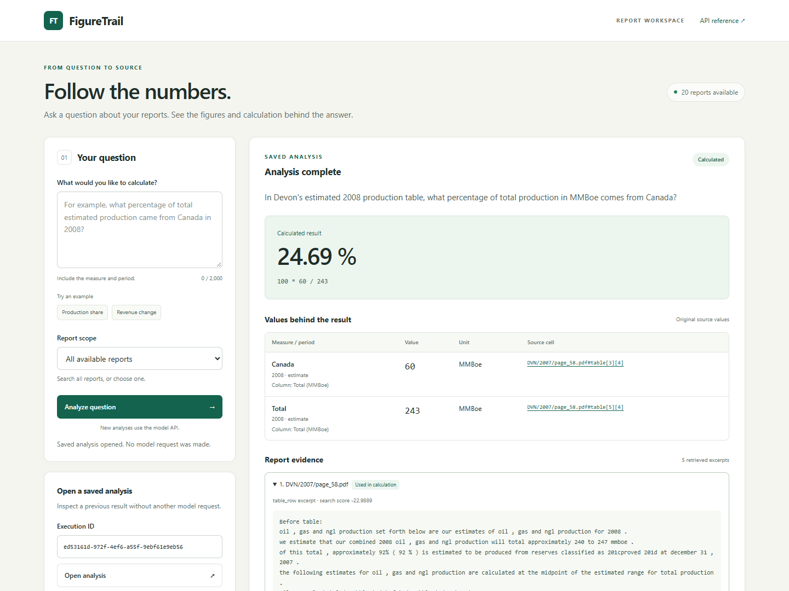

# Evidence interface verification

**Completed locally: 10 November 2026. B09. Baseline: `92db8b0a23c92b99216a78c1c7fb2fe111eb2cff`.**

One HTML/CSS/JavaScript page is served by FastAPI at `/`, with assets under `/static/`. The page uses the existing `/reports`, `POST /analyses` and `GET /analyses/{run_id}` contracts. No frontend framework, build step, application dependency or API-schema change was added. The API keeps its existing fixed semantic k=5 behavior.

## Implemented behavior

- A labeled question form, character limit, optional single-report scope or all reports, example questions and explicit submission.
- Waiting state, disabled controls and duplicate-submit protection. Loading clears the previous numerical answer.
- Original operand strings, row/column labels, units/scales, recorded periods, server-supplied formula/result, source-cell links and expandable report excerpts with original headers/context.
- Separate states for insufficient evidence, unsupported questions, unfinalized executions, blocked work and technical failures. Failure does not leave an old answer visible.
- Execution lookup, bookmarkable `?run=<UUID>` URLs and manual saved-result refresh. Page load and lookup make GET requests only; new model work requires submission.
- Public execution details/JSON. Unknown usage/charges remain null. Search scores are not presented as confidence scores. Source IDs do not pretend to open unavailable original PDFs.
- Responsive layout with an independently scrollable source table, native control labels, status announcements, focus styles and reduced-motion handling. This is not a full accessibility certification.

All source/question/response strings are assigned with DOM `textContent`. No returned HTML is interpreted or executed. The page's Content Security Policy allows same-origin resources and denies objects, base changes and framing; it supplements text-safe rendering. Existing Host/Origin checks also protect the UI and assets. Static serving is limited to `app/static/`; attempts to read code, secrets or local databases through it return 404. A fresh checkout can serve the UI without credentials/index files; new analysis is disabled when report listing is unavailable, while saved lookup remains usable.

## Backend and browser verification

Added two regression tests in `tests/test_api.py` before serving existed; both initially failed with 404. They now verify HTML/assets, CSP/MIME headers, local-file/traversal rejection, Host/Origin guards, no provider/journal initialization and key-free availability without an index. Existing JSON OpenAPI route tests continue to pass because UI routes are excluded from the API schema.

All **74 offline tests pass in 13.026 s**, including 19 API tests. Ruff lint and the documented 30-file Python formatting scope pass. Environment, ten-case source checks, prepared corpus and index checks also pass with model keys empty. The existing TestClient/httpx deprecation warning remains visible.

Browser verification used Playwright 1.65.0 with Edge 157.0.4341.42, desktop 1440×1080 and emulated mobile 390×844. Playwright was installed only in a task-isolated tool environment; it is not an application dependency. The connected browser/Node tools lacked their Node runtime, so the check used the already installed Edge channel following [Playwright's browser guidance](https://playwright.dev/python/docs/browsers#google-chrome--microsoft-edge). No browser installation or user-profile automation was needed.

Twelve interaction checks passed:

1. Startup lists reports without POST/model requests.
2. Submission through real local HTTP shows original values, formula, periods, units and five excerpts.
3. Source links open the relevant excerpt; bookmark reload uses GET only.
4. Insufficient evidence clears the prior answer and retains excerpts.
5. A simulated SDK HTTP 503 is a technical failure with no numerical answer.
6. Hostile HTML in question, source text and row labels remains literal text: no injected elements, script effects or probe request.
7. Unknown IDs give a clear message; malformed IDs are rejected before requesting.
8. An intercepted 504 envelope preserves the execution ID; manual lookup displays its unfinalized state without POST.
9. Waiting disables controls, clears old output and prevents a second submission.
10. Blank questions make no POST; question/scope controls have native labels.
11. Mobile has no page-wide horizontal overflow; table scrolling stays inside its region.
12. An intercepted reports-unavailable response disables new work while saved lookup remains available.

These checks used a temporary corpus/journal and simulated SDK responses. The 504/report-unavailable envelopes were intercepted specifically to exercise the browser states. They made **zero live AI requests** and did not change the project's journal. No browser JavaScript/page errors or CSP violations were observed. This task-local browser harness is not part of the GitHub CI job; the committed route tests run in CI.

## Real saved result and period correction

A second key-free server opened genuine B08 lexical C01 execution `ed53161d-972f-4ef6-a55f-9ebf61e9eb56` through GET only, with the real 20-report corpus. It displayed original Canada/Total values 60/243 and `100 * 60 / 243 = 24.69 %`. The project journal retained its exact bytes. The screenshot below is a saved live result, not a simulated answer or a new model request.



Visual review caught a presentation issue: this saved record has `year=2008`, `nature=estimate` and nearby reserve-context `date=2007-12-31`. Prioritizing the date displayed the wrong calculation period. The UI now displays a date only when its year matches the recorded period year; otherwise it displays the year. Assertions confirm **2008 · estimate** for both operands and absence of 2007-12-31 from the source-values table. Raw context remains visible in execution JSON; stored records, source values and calculator behavior were not rewritten.

[Insufficient-evidence screenshot](assets/b09-no-answer.png) and [mobile screenshot](assets/b09-mobile.png) use isolated test fixtures, not live-model measurements. [Structured results](B09_EVIDENCE_INTERFACE_RESULTS.json) identify tool versions, all checks, source/screenshot hashes and the preview's read-only evidence.

## Use and reproduce

From the project root, after the existing data/index setup:

```powershell
uv run --locked python -m uvicorn app.main:app --host 127.0.0.1 --port 8000 --workers 1
```

Open `http://127.0.0.1:8000/`. Use the original application origin, not an HTML file opened directly from disk. A configured backend model key is required for new analyses; the browser never receives it. Use an execution ID from the local journal to open a saved result, or a bookmark such as `http://127.0.0.1:8000/?run=<execution-id>`. Local journals/IDs are not shipped in a fresh GitHub checkout.

```powershell
uv run --locked python -B -X utf8 -m unittest discover -s tests -p test_api.py -k interface -v
uv run --locked ruff check .
uv run --locked python -B -X utf8 -m unittest discover -s tests -v
git diff --check
```

The full formatting/data/corpus/index commands are listed in README. The task-only browser command used `uv run --no-project --python <project-python> --with playwright==1.65.0 python <browser-check-script>` with a separate tool cache. Reproduce the browser scenarios above against an isolated test server with simulated model responses; use saved-result GETs for a no-cost real-data preview. Do not repeat live evaluations to verify the page.

## Preservation and limits

Original dependencies/lock/Python pin, prompts, corpus/index/document/query caches, provider journal, historical analyses/campaigns, prior reports and private PDFs/assets retain their fingerprints. The private workflow guide is intentionally updated. No model requests, billing changes, budget resets, staging, commit, push or GitHub issue/board writes occurred. Temporary test/preview servers were stopped. A port-restart attempt found the original task server still running after interruption; verification reused it rather than replacing project data.

The preceding [B08 GitHub run](https://github.com/FekherJ/FigureTrail/actions/runs/42689851809) passes 72 tests in 6.097 s. These B09 changes have 74 local tests and await user publication. UI work does not establish new model accuracy, fix provider 503s, provide public authentication or forcibly cancel remote work. Browser waiting is capped at 75 seconds; a disconnect/timeout explains that submitted work may still be finalizing. No automatic resubmission or polling is performed.

B10, the bounded agent, remains the next planned feature. Existing source-format, provider-reliability and reserved-case validation limits remain open.
